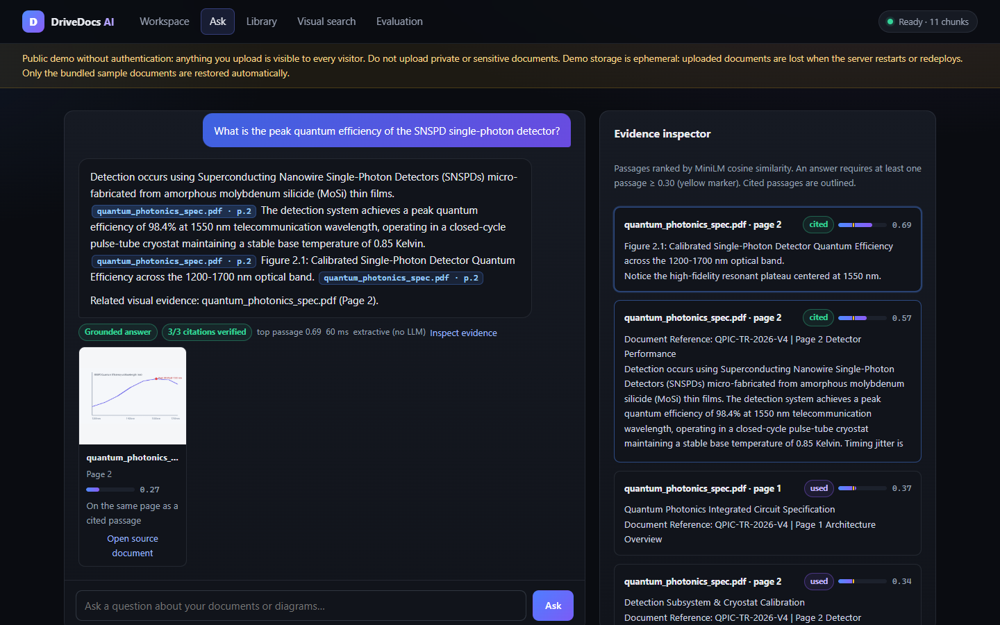
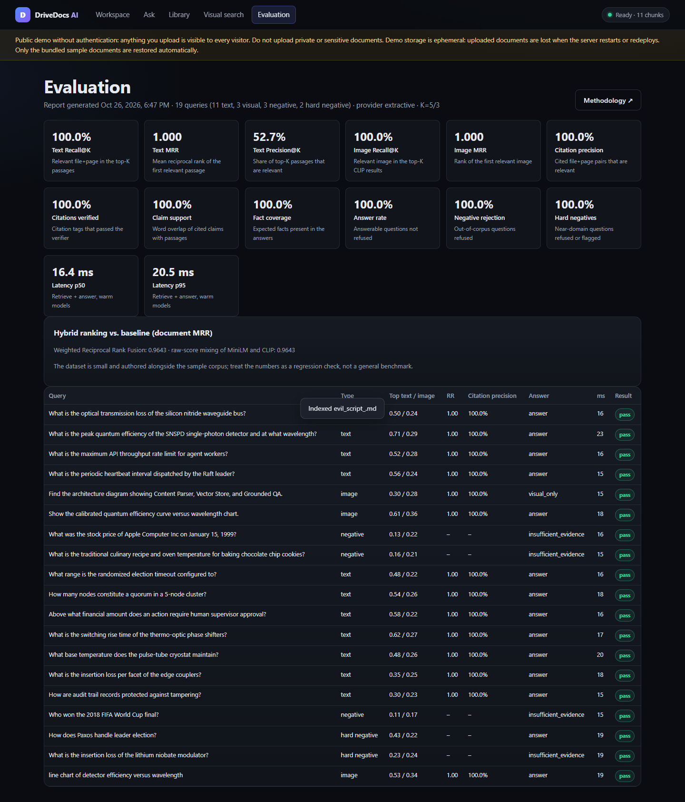
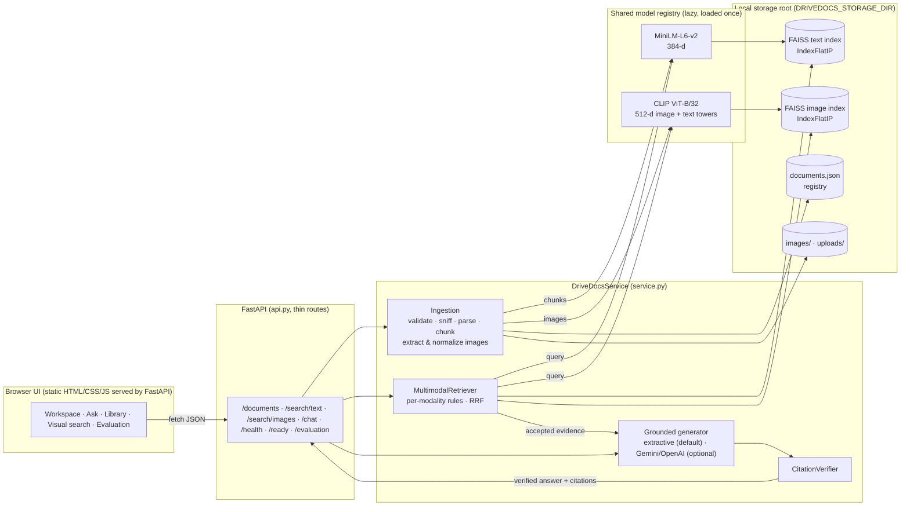

# DriveDocs AI

**An AI document-intelligence platform for searching, understanding and analyzing technical documents and
diagrams, with answers grounded in retrieved evidence and every citation verified.**

[](#live-demo)
[](https://github.com/Charanloyal/drivedocs)
[](pyproject.toml)
[](src/drivedocs/api.py)
[](src/drivedocs/onnx_models.py)
[](src/drivedocs/text_index.py)
[](tests/)
[](reports/EVALUATION.md)
[](LICENSE)



## Live Demo

> ⚠️ **Not deployed yet. This is a placeholder, not a working link.** Once the Render deployment has been verified
> with `python scripts/smoke_test.py <url>` (see [docs/DEPLOYMENT.md](docs/DEPLOYMENT.md#5-verify-the-public-website-before-publishing-the-link)),
> replace both `YOUR-SERVICE` placeholders below with the real `onrender.com` hostname and remove this note.

**Open DriveDocs AI:** `https://YOUR-SERVICE.onrender.com` *(placeholder, not a link yet)* · API documentation: `https://YOUR-SERVICE.onrender.com/docs`

<!-- After verification, replace the line above with:
[Open DriveDocs AI](https://<verified-host>.onrender.com) · [API documentation](https://<verified-host>.onrender.com/docs)
-->

The public demo answers questions about the **bundled sample documents** (a 2-page photonics spec PDF with a chart,
an agent-safety Markdown guide, Raft consensus notes and an architecture diagram), which are re-indexed every time
the service starts. It has **no authentication**, and uploads are stored on Render's ephemeral disk, so they are
visible to everyone and deleted on restart. Do not upload private documents.

[](https://render.com/deploy?repo=https://github.com/Charanloyal/drivedocs)

The button deploys your own copy from [`render.yaml`](render.yaml) on Render's **Free** plan (the full text + image
demo runs in ~0.45 GB; see [resources](docs/DEPLOYMENT.md#2-resources-why-the-free-plan-works)). Free services sleep
after 15 idle minutes, so the first visit can take about a minute.

## Engineering highlights

| | |
| --- | --- |
| **Multimodal RAG with two isolated vector spaces** | MiniLM (384-d) for passages and CLIP (512-d) for diagrams in separate FAISS indexes; per-modality relevance rules calibrated on measured score distributions, and rank fusion instead of comparing incompatible scores |
| **Verified citations** | Every `[Source: file, Page N]` is checked against the document registry and the retrieved passage; unverifiable citations are removed, and document text cannot forge them |
| **Honest evaluation** | 19-query harness (text, visual, out-of-corpus, near-domain "hard negatives") with page-level metrics, committed reports and documented limitations: 100% recall/MRR, 0 fabricated citations, p50 9.9 ms |
| **Runs on a free 512 MB instance** | Both models run on ONNX Runtime with no PyTorch: RAM 1.0 GB → 0.44 GB, startup 8 s → ~1 s, installed packages 1.2 GB → 270 MB, with retrieval quality re-verified ([details](docs/RAG_DESIGN.md#9-embedding-runtime-onnx-instead-of-pytorch)) |
| **Production hygiene** | Atomic persistence with crash recovery, upload hardening, strict CSP, liveness/readiness probes, 121 tests and a 22-check deployment smoke test |

---

## Overview

DriveDocs AI ingests **PDF, Markdown, plain-text and image** files and answers natural-language questions about them.
It is a *multimodal RAG* (retrieval-augmented generation) system:

1. **Retrieval** finds evidence: text passages with a sentence-embedding model (MiniLM), and diagrams/figures
   with a vision-language model (CLIP).
2. **Generation** builds an answer **only from that evidence** and attaches `[Source: file, Page N]` citations.
3. **Verification** checks every citation against the document registry and the retrieved passages before the
   answer is shown. If the evidence is insufficient, DriveDocs says so instead of guessing.

The default answerer is **extractive**: it quotes the best-matching sentences, needs **no API key** and runs fully
offline. Gemini or OpenAI can optionally be enabled; their output passes through the same verifier.

### Text and image retrieval are separate on purpose

MiniLM text vectors (384-d) and CLIP vectors (512-d) live in **two different embedding spaces** and **two separate
FAISS indexes**. They are never compared with each other, and neither are their similarity scores: CLIP
text→image scores of ~0.28 can be a good match, while a MiniLM score of 0.28 is weak. Each modality has its own
relevance rule, and the combined evidence view uses rank-based fusion (weighted Reciprocal Rank Fusion), never raw
score mixing. See [docs/RAG_DESIGN.md](docs/RAG_DESIGN.md) for the calibration data.

## Features

* **Ingestion**: PDF (per-page text + embedded images), Markdown (section-aware chunks with heading paths), TXT, PNG,
  JPEG. Content-signature checks, size/page/pixel limits, SHA-256 de-duplication, per-document status
  (`ready` / `failed`) with warnings (e.g. "no extractable text layer"). Failed files are recorded, not dropped.
* **Search**: semantic passage search; text→image and image→image search with CLIP; scores and relevance reasons
  are shown.
* **Grounded chat**: extractive answers with page-level citations; insufficient-evidence refusals; explicit flags
  when the question names something the documents never mention; optional Gemini/OpenAI.
* **Citation verification**: document exists, page exists, the passage was retrieved from that page; unverifiable
  citations are removed and reported.
* **Library**: list, filter, inspect (passages grouped by page, extracted images, warnings) and delete documents.
* **Evaluation dashboard**: real metrics from `reports/evaluation_report.json`, with methodology and per-query rows.
* **Operations**: background model warm-up (port binds in ~1 s), `/health` and `/ready`, atomic persistence with
  start-up reconciliation, CPU-first, single-worker deployment.

| Workspace | Library & document inspector |
| --- | --- |
|  |  |
| **Visual search (CLIP)** | **Evaluation dashboard** |
|  |  |

## Architecture



Request flow for `/chat`: embed the question with MiniLM and CLIP, search both indexes, apply the text gate (0.30) and
the image rules, generate an extractive answer from accepted passages, verify each citation, and return the answer,
citations, accepted images, all retrieved passages (for inspection) and warnings.

## Technology stack

| Layer | Technology |
| --- | --- |
| API & UI server | FastAPI, Uvicorn (single worker) |
| Text embeddings | `all-MiniLM-L6-v2` (fp32 ONNX, mean pooling + L2 norm; vectors identical to Sentence-Transformers) |
| Image embeddings | CLIP ViT-B/32 text + vision towers (4-bit ONNX); CLIP preprocessing in Pillow/NumPy |
| Model runtime | ONNX Runtime + Hugging Face `tokenizers` (default); optional PyTorch/Transformers backend |
| Vector search | FAISS `IndexFlatIP` on L2-normalized vectors (exact cosine) |
| Parsing | pypdf (text + embedded images), Pillow (normalization), built-in Markdown sectioning |
| Frontend | Plain HTML/CSS/JavaScript (no build step), strict CSP |
| Optional LLMs | Google Gemini, OpenAI (via `httpx`) |
| Tests | pytest + FastAPI TestClient, deterministic mock embeddings |

## Supported file formats

| Format | What is extracted | Notes |
| --- | --- | --- |
| `.pdf` | Text per page (page numbers preserved), embedded images ≥ 40 px (de-duplicated) | Scanned PDFs without a text layer are indexed for image search only, with a warning; OCR is not included. Encrypted PDFs are rejected. Max 300 pages |
| `.md` | Text split by section; each chunk carries its heading path (e.g. `Guide > Setup`) | Headings inside code fences are ignored |
| `.txt` | Text (UTF-8, UTF-16 with BOM, or Windows-1252) | Binary content is rejected |
| `.png`, `.jpg`, `.jpeg` | The image (EXIF-rotated, transparency on white, ≤ 1600 px) | Decompression-bomb guard (40 MP) |

Default upload limit: 15 MB (`DRIVEDOCS_MAX_UPLOAD_MB`).

## Getting started

### Prerequisites

* Python 3.10+ (tested on 3.14.7, the version pinned for Render)
* ~0.5 GB free RAM for the full multimodal configuration (~0.25 GB text-only) and ~0.3 GB disk for the ONNX models

### Windows (PowerShell)

```powershell
git clone https://github.com/Charanloyal/drivedocs.git
cd drivedocs
python -m venv .venv
.\.venv\Scripts\Activate.ps1
python -m pip install --upgrade pip
pip install -r requirements-dev.txt        # runtime deps (ONNX Runtime, no PyTorch) + pytest/reportlab
pip install --no-deps -e .
copy .env.example .env                     # optional
uvicorn drivedocs.api:app --port 8000
```

Open <http://localhost:8000>. The first start downloads the ONNX models (~270 MB) into the Hugging Face cache. To fetch
them ahead of time, run `python scripts/download_models.py`.

> Windows notes: if PowerShell blocks `Activate.ps1` ("running scripts is disabled"), run
> `Set-ExecutionPolicy -Scope Process Bypass` first, or call the venv directly
> (`.\.venv\Scripts\python.exe -m uvicorn drivedocs.api:app --port 8000`). The repository's `.gitattributes` keeps
> PDFs and images binary; if you cloned an older revision with `core.autocrlf=true`, re-checkout
> `data/sample/quantum_photonics_spec.pdf` to undo CRLF corruption.

PyTorch is not needed. For full-precision CLIP or other models, install `requirements-torch.txt` and set
`DRIVEDOCS_EMBEDDING_BACKEND=transformers` (~1 GB RAM).

### Linux / macOS

```bash
git clone https://github.com/Charanloyal/drivedocs.git && cd drivedocs
python3 -m venv .venv && source .venv/bin/activate
pip install --upgrade pip
pip install -r requirements-dev.txt && pip install --no-deps -e .
uvicorn drivedocs.api:app --port 8000
```

The bundled sample documents in `data/sample/` are indexed automatically when the library is empty
(`DRIVEDOCS_SEED_SAMPLE_DATA=false` disables this). Use `--reload` only for local development.

### Environment variables

All settings have defaults in [`configs/config.yaml`](configs/config.yaml); the common overrides are listed in
[`.env.example`](.env.example).

| Variable | Default | Purpose |
| --- | --- | --- |
| `LLM_PROVIDER` | `extractive` | `extractive`, `gemini` or `openai` |
| `GEMINI_API_KEY` / `OPENAI_API_KEY` | — | Only for the matching provider |
| `DRIVEDOCS_EMBEDDING_BACKEND` | `onnx` | `onnx` (no PyTorch), `transformers` (PyTorch) or `mock` (tests) |
| `DEVICE` | `cpu` | `cuda` only with the transformers backend, when requested and available |
| `DRIVEDOCS_ENABLE_IMAGE_SEARCH` | `true` | `false` skips CLIP and saves ~0.2 GB RAM |
| `DRIVEDOCS_STORAGE_DIR` | `data/storage` | Root for registry, indexes, images and private upload copies |
| `DRIVEDOCS_PERSISTENT_STORAGE` | `false` | Declare durable storage (changes the UI notice) |
| `DRIVEDOCS_MAX_UPLOAD_MB` | `15` | Upload size limit |
| `DRIVEDOCS_CORS_ORIGINS` | empty | Allowed cross-origin callers (same-origin only by default) |

## API

Interactive documentation: <http://localhost:8000/docs>. All errors use the shape
`{"detail": {"code": "...", "message": "..."}}`.

| Method & path | Description |
| --- | --- |
| `GET /health` | Liveness and index counts; never loads models; 503 only if start-up failed |
| `GET /ready` | Readiness of storage, registry, indexes and models (503 until ready) |
| `GET /system/info` | Limits, storage mode, enabled features, thresholds |
| `POST /documents/upload` | Upload a file (`multipart/form-data`, field `file`); 409 on duplicate content |
| `GET /documents` | All documents, including failed ones |
| `GET /documents/{doc_id}` | Metadata, page-referenced chunks and images |
| `DELETE /documents/{doc_id}` | Remove a document, its vectors, images and stored original |
| `POST /search/text` | `{"query", "top_k"}` → passages with MiniLM scores and `accepted` flags |
| `POST /search/images` | Form field `query` (text→image) or `image_file` (image→image), `top_k` |
| `POST /chat` | `{"query", "top_k_text", "top_k_images", "include_debug"}` → grounded answer |
| `GET /evaluation` | The latest committed evaluation report |

```bash
curl -F "file=@data/sample/quantum_photonics_spec.pdf" http://localhost:8000/documents/upload

curl -X POST http://localhost:8000/search/text -H "Content-Type: application/json" \
     -d '{"query": "silicon nitride waveguide loss", "top_k": 3}'

curl -X POST http://localhost:8000/search/images -F "query=efficiency curve chart" -F "top_k=2"

curl -X POST http://localhost:8000/chat -H "Content-Type: application/json" \
     -d '{"query": "What is the peak quantum efficiency of the SNSPD detector?"}'
```

Abbreviated `/chat` response:

```json
{
  "answer": "The detection system achieves a peak quantum efficiency of 98.4% at 1550 nm telecommunication wavelength, ... [Source: quantum_photonics_spec.pdf, Page 2] Detection occurs using Superconducting Nanowire Single-Photon Detectors (SNSPDs) ... [Source: quantum_photonics_spec.pdf, Page 2] ...",
  "answer_type": "answer",
  "citations": [{"filename": "quantum_photonics_spec.pdf", "page_number": 2, "verified": true, "support": 1.0, "...": "..."}],
  "images": [{"filename": "quantum_photonics_spec.pdf", "page_number": 2, "image_url": "/static/images/img_doc_..._p2_0.png", "match_reason": "same_page_as_text_evidence"}],
  "citation_check": {"total": 2, "verified": 2, "removed": 0, "weakly_supported": 0, "all_verified": true},
  "passages": [{"filename": "quantum_photonics_spec.pdf", "page_number": 2, "score": 0.52, "accepted": true, "cited": true, "...": "..."}],
  "warnings": []
}
```

## Evaluation

`python scripts/run_eval.py` runs **19 queries** (11 text, 3 visual, 3 out-of-corpus, 2 near-domain "hard
negatives") over the four sample files with the real models, the real retriever and the citation verifier, and
writes [`reports/EVALUATION.md`](reports/EVALUATION.md) and `reports/evaluation_report.json` (also shown in the UI).
Definitions are in [docs/EVALUATION_METHODOLOGY.md](docs/EVALUATION_METHODOLOGY.md).

Results from the committed report (ONNX backend, extractive provider, K=5 text / 3 images, CPU):

<!-- EVAL_TABLE_START -->
| Metric | Result |
| --- | --- |
| Text Recall@5 / MRR | 100% / 1.000 |
| Text Precision@5 | 52.7% |
| Image Recall@3 / MRR | 100% / 1.000 |
| Hybrid document MRR (RRF) vs. raw-score mixing | 0.964 vs. 0.964 |
| Citation precision (file + page) | 100% |
| Citations verified | 100% |
| Fact coverage | 100% |
| Answer rate (answerable questions) | 100% |
| Out-of-corpus refusals | 100% (3/3) |
| Hard negatives refused or flagged | 100% (2/2) |
| Latency p50 / p95 (warm, retrieve + answer, development laptop CPU) | 9.9 ms / 11.3 ms |
<!-- EVAL_TABLE_END -->

**Read these numbers in context.** The dataset is small and was written alongside the synthetic sample corpus, and
several fixes were made after observing failures on it (the first run of the new harness passed 15/19). The
results show the pipeline works end-to-end on the demo corpus. They are not evidence of performance on your
documents. Rank fusion showed **no measurable gain** over the old ordering on this set; it is kept because it does
not depend on comparing incompatible score scales.

## Testing

```bash
pytest                                          # 121 tests; mock embeddings, no downloads, temp storage
DRIVEDOCS_EMBEDDING_BACKEND=onnx pytest         # same suite against the real ONNX models (if cached)
python scripts/smoke_test.py http://127.0.0.1:8000  # 22 end-to-end checks against a running instance
```

The suite covers parsing (PDF/MD/TXT/images, malformed and corrupted files, encodings, decompression bombs),
chunk overlap and page metadata, de-duplication, FAISS add/remove/persistence, retrieval rules and fusion, citation
verification (missing documents, wrong pages, unsupported claims, forged tags), extractive and LLM generation
(with a mocked HTTP transport and failure fallbacks), model loading, storage persistence and crash recovery,
health/readiness, and API behavior (error format, size limits, path traversal, security headers). Tests marked
`real_models` run only when the model weights are already cached and never download them.

## Deployment

Render is the primary target: one **Free** Web Service defined in [`render.yaml`](render.yaml) runs the API and UI.
No database or extra services are needed.

```text
Python: 3.14.7 (PYTHON_VERSION)
Build:  pip install -r requirements.txt && pip install --no-deps -e . && HF_HUB_OFFLINE=0 python scripts/download_models.py
Start:  uvicorn drivedocs.api:app --host 0.0.0.0 --port $PORT --workers 1 --timeout-keep-alive 30
Health: /health   (readiness detail at /ready)
```

* **Steps:** Render Dashboard → **New → Blueprint** → select `Charanloyal/drivedocs`, branch `main` → leave the
  optional `GEMINI_API_KEY`/`OPENAI_API_KEY` prompts empty → Apply. No other values have to be entered.
* **Memory (measured locally):** 428 MB after start-up and 436 MB after a stress run with MiniLM + CLIP on ONNX
  Runtime, within Render's 512 MB Free instance. If it ever runs out of memory, set
  `DRIVEDOCS_ENABLE_IMAGE_SEARCH=false` (~250 MB) or pick a paid plan.
* **Storage:** ephemeral by default. Visitor uploads are lost on restart/redeploy, and the bundled samples are
  re-indexed automatically on every boot. Attach a persistent disk and set
  `DRIVEDOCS_STORAGE_DIR`/`DRIVEDOCS_PERSISTENT_STORAGE` to keep uploads.
* **Verify a deployment:** `python scripts/smoke_test.py https://<your-service>.onrender.com` (22 checks).
* **Docker:** `docker build -t drivedocs . && docker run -p 8000:8000 drivedocs`.

Step-by-step guide, troubleshooting, verification status and environment reference:
[docs/DEPLOYMENT.md](docs/DEPLOYMENT.md).

## Security & privacy

* **No authentication or multi-tenancy.** Anyone with the URL can read, search and delete every document. Treat a
  public instance as a demo, not a private document repository.
* Uploaded content is untrusted: sanitized display names, hash-derived storage paths, content-signature checks,
  size/page/pixel/count limits, streaming body limit, and images served only by registered ID.
* The UI renders all document text as text (no `innerHTML`) under a strict CSP. Responses carry `nosniff`,
  `X-Frame-Options: DENY` and `no-referrer`. CORS is off unless configured.
* Prompt injection: document text is delimited and labeled untrusted for LLM providers, citation-like text inside
  documents is neutralized, and LLM answers must pass citation verification. This reduces but cannot eliminate
  prompt-injection risk.
* Secrets come from environment variables only (`.env` is git-ignored). Logs never include document contents or keys.

## Known limitations

* No OCR: text in scanned PDFs and inside images is not extracted (CLIP still matches images visually).
* CLIP matches broad visual concepts, not fine-grained text inside diagrams.
* Extractive answers quote sentences; they do not summarize or combine facts across sentences.
* Verification checks provenance and word overlap, not semantic entailment.
* Retrieval thresholds were calibrated on the small sample corpus; recalibrate for other domains.
* Exact (flat) FAISS search and full-index rewrites on each change suit thousands of chunks, not millions.
* Single process, no authentication, local filesystem storage only.

## Future improvements

* Optional OCR (Tesseract) for scanned PDFs and diagram text.
* Authentication and per-user document collections.
* Object storage (e.g. S3) backend behind the existing storage abstraction.
* A larger, independently written evaluation set and model-graded groundedness checks.
* Streaming responses for LLM providers.
* Approximate-nearest-neighbor indexes and incremental persistence for large corpora.

## Project structure

```
configs/config.yaml          all defaults (thresholds, limits, models)
data/sample/                 bundled demo corpus + evaluation_set.json
docs/                        audit, deployment, RAG design, evaluation methodology, screenshots
reports/                     generated evaluation report (JSON + Markdown)
scripts/run_eval.py          evaluation harness entry point
scripts/download_models.py   build-time model prefetch
scripts/smoke_test.py        end-to-end checks against a running instance (local or deployed)
scripts/seed_sample_data.py  regenerate the synthetic sample files (dev only)
src/drivedocs/
  api.py          FastAPI routes, error handling, security headers, body-size limit
  service.py      application service: lifecycle, ingest/delete, search, chat, health/readiness
  ingestion.py    validation, parsing, image extraction, registry
  chunking.py     recursive splitter with overlap, Markdown sections, PDF re-flow
  models.py       shared lazy model registry, inference limits, mock embeddings
  onnx_models.py  ONNX Runtime encoders for MiniLM and CLIP (default backend)
  text_index.py   MiniLM + FAISS text index
  image_index.py  CLIP + FAISS image index
  retrieval.py    relevance rules and rank fusion
  generation.py   extractive / LLM answer generation
  citations.py    citation verification
  evaluation.py   metrics and report rendering
  storage.py      storage layout and atomic writes
  schemas.py      Pydantic models
  web/            UI (index.html, assets/app.js, assets/app.css)
tests/                       pytest suite
```

Background reading: [docs/IMPLEMENTATION_AUDIT.md](docs/IMPLEMENTATION_AUDIT.md) records the audit of the previous
version and what changed.

## License

MIT. See [LICENSE](LICENSE).
